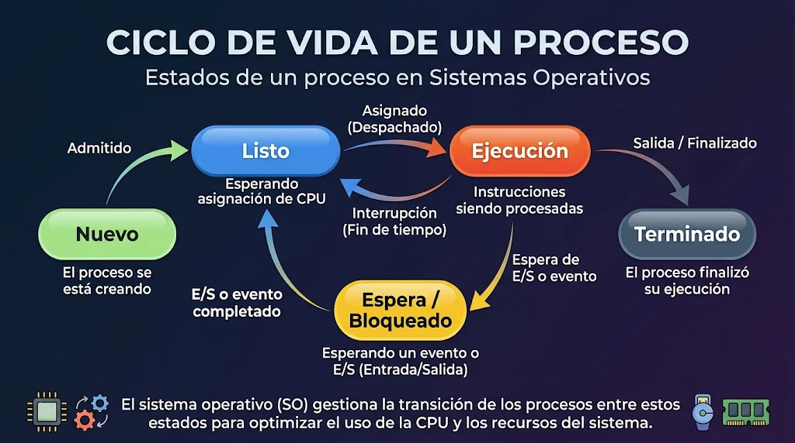
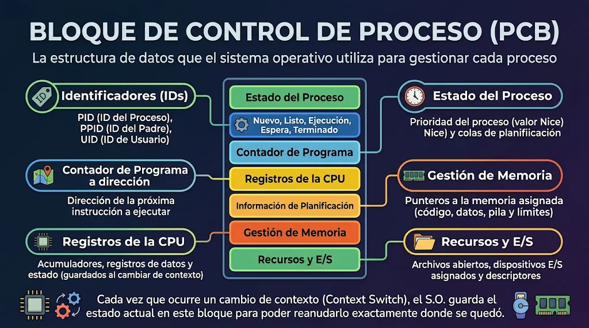

```
----------------- ADMINISTRACIÓN DE SISTEMAS INFORMÁTICOS EN RED ----------------
---------------------------------------------------------------------------------

Módulo:                     ADMINISTRACIÓN DE SISTEMAS OPERATIVOS
Profesor:                   Víctor J. González
Unidad de Trabajo:          UT05. Gestión y monitorización de procesos
Apartado:                   Introducción a los procesos
Resultados de aprendizaje:  RA2
```


# UT05.- GESTIÓN Y MONITORIZACIÓN DE PROCESOS

## 1.- Introducción a los procesos

Todos los ordenadores modernos pueden hacer varias cosas al mismo tiempo. Ahora bien, en términos estrictos la CPU únicamente pueden ejecutar un programa en un instante dado. Para
dar la sensación de simultaneidad en la ejecución lo que se hace es alternar la ejecución de varios programas muy rápidamente, lo que se conoce como pseudoparalelismo, en contraste con el verdadero paralelismo hardware de los sistemas multiprocesador.

En estos sistemas todo el software de la computadora se organiza en varios **procesos secuenciales**, o simplemente procesos. Un proceso no es más que un **programa en ejecución**, e incluye los valores que tienen el contador de programa, los registros y las variables. En lo conceptual cada proceso tiene su propia CPU virtual, aunque en la realidad la verdadera CPU cambia continuamente de un proceso a otro. Esta rápida conmutación se llama **multiprogramación**

## 2.- El ciclo de vida de los procesos

### 2.1.- Creación de procesos

En los sistemas operativos normalmente hace falta un mecanismo para crear y terminas procesos según se necesite durante la operación. Hay cuatro sucesos principales que causan la creación de procesos:

- **Inicialización del sistema**: cuando se arranca el sistema operativo se crean varios procesos. Algunos son de **primer plano**, es decir, que interactúan con el usuario, y otros son en **segundo plano**, que no están asociados con un usuario en particular, sino que tienen una función específica, por ejemplo, podría diseñarse un proceso que acepte el correo electrónico entrante, el cual quedaría inactivo esperando la entrada de algún correo. A los procesos que se ejecutan en segundo plano se les denomina **demonios** (*daemons*)
- **Ejecución de una llamada al sistema para crear procesos por un programa en ejecución**: es normal que un proceso en ejecución emita llamadas al sistema para crear uno o más procesos que le ayuden en su labor. La creación de procesos tiene especial utilidad cuando el trabajo a realizar puede formularse con facilidad a partir de varios procesos relacionados, pero independientes, que interactúan entre sí.
- **Solicitud de un usuario para crear un proceso**: un usuario puede crear un proceso desde la línea de comandos del sistema o a través del entorno de ventanas.
- **Como parte de un trabajo por lotes**: esta situación solo se da en los sistemas por lotes de los mainframes grandes. En ellos los usuarios pueden enviar trabajos por lotes al sistema. Cuando el sistema operativo decide que tiene los recursos suficientes para ejecutar otro trabajo, crea un proceso y ejecuta en él el siguiente trabajo de la cola de entrada.

### 2.2.- Terminación de procesos

Pero los procesos no están indefinidamente en la memoria, sino que tarde o temprano han de finalizar, debido principalmente a uno de los siguientes motivos:

- **Terminación normal**: una vez que el proceso ha finalizado las tareas que tenía que realizar se indica que ha terminado mediante una llamada al sistema operativo. Esta llamada en los sistemas UNIX es **exit**.
- **Terminación por error**: por ejemplo, cuando uno de los parámetros del proceso no es válido. Por lo general los procesos interactivos por pantalla no terminan cuando se les proporcionan parámetros no válidos, sino que muestran una ventana para reintroducir dichos parámetros.
- **Error fatal**: este motivo es producido por un error causado por el proceso, a menudo debido a un defecto en el programa, como hacer referencia a una posición de memoria no permitida o realizar una división entre cero.
- **Terminado por otro proceso**: en este caso otro proceso (que tiene los permisos necesarios) pide al sistema operativo que termine con el proceso. En UNIX la llamada es `kill`.


### 2.3.- Estados de los procesos

A lo largo de su ciclo de vida un proceso puede pasar por varios estados entre los que va cambiando como respuesta a determinados eventos. Estos estados son:

- **En ejecución**: el proceso está utilizando la CPU en ese instante.
- **Bloqueado**: tarde o temprano los procesos deberán realizar lentas operaciones de E/S, por lo que cede el turno de CPU a otro proceso, pasando al estado bloqueado hasta que se produzca el suceso que está esperando.
- **Listo**: una vez que ocurra el evento que el proceso está esperando ya podrá volver a ejecutarse, aunque deberá esperar a que la CPU se encuentre disponible. También es posible que un proceso pase a este estado por decisión del **planificador**, por ejemplo, porque haya estado demasiado tiempo ocupando la CPU. Las transiciones entre los estados listo y en ejecución y viceversa son consecuencia de las acciones del calendarizador y de las cuales el proceso ni siquiera se entera. 
- **Nuevo**: lo tienen los procesos que acaban de ser creados por el sistema operativo pero que aún no han sido admitidos en el grupo de procesos ejecutables. En este estado el proceso ya tiene asignado identificador (PID) y se han creado las estructuras de datos asociadas, pero el sistema aún no se ha comprometido a su ejecución.
- **Terminado**: corresponde a los procesos que han sido excluidos por el sistema operativo del grupo de procesos ejecutables, normalmente porque hayan finalizado su ejecución. Este estado permite conservar temporalmente las estructuras de datos asociadas al proceso, esto permite que programas auxiliares o de soporte puedan extraer información que necesiten, por ejemplo, un programa de auditoria.
- **Suspendido**: la enorme diferencia de velocidad entre el procesador y las operaciones de E/S hace que sea probable que todos los procesos que están en memoria se encuentren en estado bloqueado esperando la finalización de un evento de E/S. La solución a este problema es el **intercambio**, que significa mover un proceso de la memoria principal al disco para dejar espacio libre en memoria para otros procesos. En este caso se dice que el proceso se encuentra en estado **Bloqueado Suspendido**. Mientras el proceso se encuentra en este estado, puede ocurrir que el evento que espera tenga lugar, en cuyo caso pasará al estado **Listo Suspendido**, indicando que el proceso ya puede ejecutarse a la espera de ser trasladado a memoria.




## 2.- Tipos de procesos

### 2.1.- Jerarquía de procesos: procesos padre e hijo

En la arquitectura de los sistemas operativos, los procesos no existen de forma aislada, sino que mantienen una estricta **relación jerárquica de parentesco**. Todo proceso nuevo (proceso hijo) es creado por otro proceso ya existente (proceso padre) mediante llamadas al sistema específicas (como `fork()` y `exec()` en sistemas POSIX/Linux, o `CreateProcess()` en Windows).

- **Proceso raíz (PID 1 / Sistema):** en el arranque, el núcleo lanza un primer proceso inicial del que descenderán, directa o indirectamente, todos los demás procesos del sistema:
        - En Linux/Unix es `systemd` (o `init`) con identificador `PID 1`.
        - En Windows es el proceso `System` (`PID 4`), que inicia el Gestor de Sesiones (`smss.exe`) y los subsistemas de usuario (`wininit.exe` para servicios y `winlogon.exe` para la sesión interactiva).
- **Herencia en sesiones de usuario:** cuando abres una terminal y ejecutas un editor de texto, el emulador de terminal es el padre de la *Shell* (Bash o PowerShell), y esta es a su vez el padre del proceso del editor. De igual modo, en un entorno gráfico, el explorador de archivos o entorno de escritorio (`explorer.exe` en Windows, GNOME/Plasma en Linux) actúa como padre de las aplicaciones que lanzas desde el menú o escritorio.

Cuando un proceso termina su ejecución, el sistema operativo libera la mayor parte de sus recursos (memoria, archivos abiertos, dispositivos), pero debe conservar su **bloque de control (PCB)** y su **código de salida** (*exit status*) en la tabla de procesos hasta que su proceso padre lea dicho estado para confirmar cómo terminó la tarea. Dependiendo de cómo ocurra esta sincronización, pueden darse dos situaciones anómalas:

- **Proceso huérfano (*Orphan process*):** ocurre cuando el **proceso padre finaliza antes que el proceso hijo**. En lugar de quedar desatendido, el sistema operativo reasigna automáticamente al proceso hijo un nuevo padre adoptivo —generalmente el proceso raíz del sistema (`systemd` en Linux o el gestor de sesiones en Windows)—, garantizando así que alguien recoja su estado cuando finalmente termine.
- **Proceso zombi (*Zombie* o *Defunct*):** ocurre cuando un **proceso hijo finaliza su ejecución, pero su proceso padre sigue activo y no lee su estado de salida** (por ejemplo, debido a un error de programación en el padre que omite la llamada `wait()`). El proceso hijo ya no consume CPU ni memoria de usuario, pero su entrada permanece bloqueada en la tabla de procesos ocupando un identificador (`PID`). No es posible finalizar un proceso zombi mediante señales de terminación (como `kill -9`), ya que técnicamente ya está muerto; la única forma de eliminarlo de la tabla es forzar a que su proceso padre lea el estado o finalizar al propio proceso padre para que el proceso raíz adopte al zombi y limpie su entrada.

Todos los sistemas operativos ofrecen herramientas nativas para visualizar este árbol de parentesco, como puede ser `pstree` en Linux o *Process Explorer* de Sysinternals en Windows.




### 2.2.- Procesos automáticos e interactivos

Una clasificación fundamental de los procesos en cualquier sistema operativo moderno (como Linux, Windows o macOS) es aquella que los divide según su forma de iniciarse e interactuar con el usuario: procesos automáticos (en segundo plano) y procesos interactivos (en primer plano).

- **Procesos automáticos (servicios o demonios):** son procesos que se inician de forma autónoma durante el arranque del sistema operativo o bajo demanda del propio sistema, sin requerir la intervención directa de un usuario. Se ejecutan en **segundo plano**, lo que significa que carecen de una interfaz de usuario directa o de una terminal asociada para mostrar su salida estándar. Algunos ejemplos son: servidores web, gestores de bases de datos, planificación de tareas, gestión de red o sincronización de reloj.
        - En sistemas **Unix/Linux**, se conocen habitualmente como **demonios** (*daemons*, cuyos nombres suelen acabar en `d`, como `sshd` o `cron`) y son gestionados por un gestor de arranque e inicio como `systemd` o `init`.
        - En **Windows**, se denominan **servicios** y son administrados por el Administrador de Control de Servicios (`services.msc` / `svchost.exe`).
- **Procesos interactivos:** son aquellos iniciados directamente por un usuario a través de una interfaz, ya sea mediante una **interfaz de línea de comandos** (*CLI* o *Shell*, introduciendo el comando correspondiente en Bash, PowerShell o Zsh) o mediante una **interfaz gráfica de usuario** (*GUI*, haciendo doble clic sobre el icono de una aplicación). Estos procesos suelen ejecutarse en **primer plano** y mantienen una comunicación continua con el usuario a través de periféricos de entrada/salida (teclado, ratón, pantalla).


### 2.3.- Procesos en primer y segundo plano

Dentro de los procesos interactivos iniciados por un usuario, los sistemas operativos distinguen dos modos de ejecución según quién mantiene el control de la interfaz y cómo se gestionan la entrada y la salida: **primer plano** y **segundo plano**. Esta dualidad permite aprovechar la multitarea del sistema operativo sin bloquear el trabajo del usuario mientras se ejecutan tareas de larga duración.

- **Procesos en primer plano:** son aquellos que mantienen el foco activo de la sesión del usuario. En una interfaz de línea de comandos, el proceso en primer plano recibe directamente las pulsaciones del teclado (entrada estándar, `stdin`) y muestra sus resultados y errores en pantalla (salida estándar, `stdout`, y salida de error, `stderr`), bloqueando el intérprete hasta que finaliza o es suspendido. En un entorno gráfico, equivale a la ventana activa que recibe los eventos de ratón y teclado.
- **Procesos en segundo plano:** son procesos iniciados por el usuario que se ejecutan de forma concurrente sin bloquear la interfaz. Aunque siguen siendo procesos hijos de la sesión o de la *Shell* que los lanzó, pierden el acceso directo a la entrada estándar (no leen del teclado) para que el usuario pueda seguir introduciendo otros comandos o trabajando en otras ventanas.

En entornos de consola, un proceso en segundo plano **no** desconecta automáticamente su salida estándar ni su salida de error de la terminal. Si el proceso genera mensajes, estos seguirán apareciendo en pantalla mezclándose con lo que el usuario escriba, motivo por el cual es una buena práctica redirigir su salida hacia un archivo o hacia un sumidero nulo (`/dev/null` en Unix/Linux o `$null` en PowerShell).


Los intérpretes de comandos implementan un mecanismo denominado **control de trabajos** (*Job Control*) que permite alternar el estado de los procesos asociados a una misma sesión de terminal.

| Acción                                            | Sistemas Unix / Linux / macOS (Bash, Zsh)                                 | Windows (PowerShell)                                             |
| ------------------------------------------------- | ------------------------------------------------------------------------- | ---------------------------------------------------------------- |
| **Iniciar directamente en segundo plano**         | Añadir `&` al final del comando:<br>                                      | Usar `Start-Job`                                                 |
| **Reanudar un proceso detenido en segundo plano** | Ejecutar `bg` (o `bg %n` indicando el número de trabajo).                 | Reanudar trabajos suspendidos con `Resume-Job`.                  |
| **Listar los trabajos de la sesión actual**       | Ejecutar `jobs` (o `jobs -l` para ver también los `PID`).                 | Ejecutar `Get-Job`.                                              |
| **Traer un proceso de segundo a primer plano**    | Ejecutar `fg` (o `fg %n` para recuperar el foco y la entrada de teclado). | Recuperar la salida de un trabajo con `Receive-Job -Id n -Keep`. |


En los escritorios modernos (Windows, macOS, GNOME o KDE Plasma), el sistema operativo gestiona el primer y segundo plano de forma visual mediante el **gestor de ventanas**:

- **Primer plano:** la ventana con el foco activo, que recibe prioridad de planificación de CPU en muchos sistemas (como Windows, que otorga mayor *quantum* de tiempo a la aplicación activa) para garantizar fluidez visual.
- **Segundo plano:** aplicaciones minimizadas, en pestañas inactivas o alojadas en la bandeja del sistema (*system tray* / barra de menús), que continúan ejecutando tareas (descargas, reproducción de audio, sincronización en la nube) sin requerir atención inmediata del usuario.


