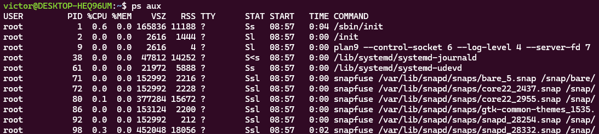
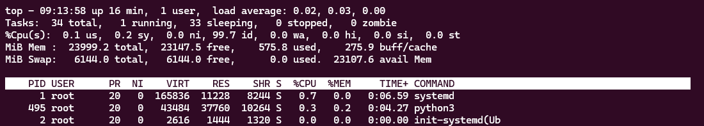
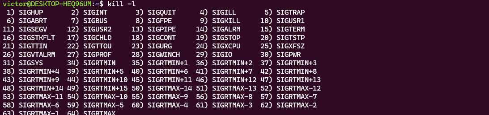

```
----------------- ADMINISTRACIÓN DE SISTEMAS INFORMÁTICOS EN RED ----------------
---------------------------------------------------------------------------------

Módulo:                     ADMINISTRACIÓN DE SISTEMAS OPERATIVOS
Profesor:                   Víctor J. González
Unidad de Trabajo:          UT05. Administración de procesos
Apartado:                   2. Procesos en Linux
Resultados de aprendizaje:  RA2
```


# UT04.- ADMINISTRACIÓN DE PROCESOS

## 2.- Procesos en Linux

Una vez comprendido cómo el núcleo estructura, planifica y comunica los procesos (mediante su PCB, estados, prioridades y señales), resulta inmediato entender las herramientas de administración en GNU/Linux. En esencia, todos estos comandos consultan o modifican la información que el *kernel* expone dinámicamente a través del sistema de archivos virtual **`/proc`**.

En la siguiente tabla puedes ver un resumen de todos los comandos de Linux relacionados con procesos:

| Objetivo del comando                                | Herramienta / Comando en Linux             | Operación sobre el sistema                                                     |
| --------------------------------------------------- | ------------------------------------------ | ------------------------------------------------------------------------------ |
| **Identificación (`PID`, `PPID`, `UID`) y estados** | `ps`, `pgrep`, `pidof`                     | Toma una instantánea estática de la tabla de procesos y sus estados.           |
| **Jerarquía de parentesco y hilos (*Threads*)**     | `pstree`, `ps -ef --forest`, `ps -eLf`     | Visualiza las relaciones padre-hijo y desglosa los hilos de cada proceso.      |
| **Monitorización dinámica y consumo de recursos**   | `top`, `htop`, `btop`                      | Supervisa en tiempo real el uso de CPU, memoria y cambios de estado.           |
| **Planificación de CPU y valor *Nice***             | `nice`, `renice`                           | Ajusta la prioridad de planificación (`NI` de `-20` a `+19`).                  |
| **Control de trabajos (*Job Control*) y sesiones**  | `&`, `Ctrl+Z`, `jobs`, `bg`, `fg`, `nohup` | Alterna procesos entre primer y segundo plano o los desvincula de la terminal. |
| **Comunicación y envío de Señales (*Signals*)**     | `kill`, `pkill`, `killall`                 | Envía señales (`SIGTERM`, `SIGKILL`, `SIGHUP`) por `PID` o por nombre.         |


### 2.1.- Instantáneas del sistema: el comando `ps`

El comando `ps` (*Process Status*) muestra una fotografía fija de los procesos activos en el instante exacto de su ejecución. Admite dos estilos de opciones históricos (estilo UNIX con guion `-` y estilo BSD sin guion), siendo estas las combinaciones fundamentales para administración:

| Objetivo                                        | Comando              | Descripción y columnas clave                                                                                                                                                                          |
| ----------------------------------------------- | -------------------- | ----------------------------------------------------------------------------------------------------------------------------------------------------------------------------------------------------- |
| **Ver los procesos de la sesión actual**        | `ps -f`              | Muestra el propietario (`UID`), el identificador (`PID`), el proceso padre (`PPID`), el tiempo de CPU y el comando ejecutado en la terminal actual                                                    |
| **Ver todos los procesos del sistema**          | `ps aux`<br>`ps -ef` | *(estilo BSD)*: muy habitual para ver el consumo de CPU (`%CPU`) y memoria RAM (`%MEM`).<br>*(estilo UNIX)*: ideal para rastrear las relaciones de parentesco entre `PID` y `PPID`. |
| **Visualizar la jerarquía padre-hijo en árbol** | `ps -ef --forest`    | Cumple una función similar a `pstree`, dibujando con líneas ASCII qué proceso ha creado a cuál                                                                                                        |
| **Inspeccionar hilos de los procesos**          | `ps -eLf`            | Añade las columnas `LWP` (*Light Weight Process*, identificador de cada hilo) y `NLWP` (número total de hilos del proceso) para ver procesos multihilo.                                               |


Al ejecutar `ps aux`, las columnas conectan directamente con los conceptos que vimos en el apartado anterior:

- **`USER` / `PID`:** usuario propietario (`UID`) e identificador único del proceso.
- **`%CPU` / `%MEM`:** porcentaje de tiempo de procesador y de memoria física (RAM) consumidos.
- **`VSZ` / `RSS`:** memoria virtual total asignada frente a la memoria física real residente en RAM (*Resident Set Size*, en KiB).
- **`TTY`:** terminal asociada al proceso. Si aparece un **`?`**, indica que el proceso **no tiene terminal asociada**, característica propia de los demonios lanzados por `systemd`.
- **`STAT`:** código de estado del proceso, que refleja el diagrama del ciclo de vida:
    - **`R` (*Running / Runnable*):** en ejecución en la CPU o en la cola de **Listo** esperando su *quantum*.
    - **`S` (*Interruptible Sleep*):** bloqueado o en espera de un evento o de E/S (por ejemplo, esperando pulsaciones de teclado o datos de red).
    - **`D` (*Uninterruptible Sleep*):** espera ininterrumpible de E/S (habitualmente acceso a disco); no responde a señales hasta que el hardware termina.
    - **`T` (*Stopped*):** detenido/suspendido (por ejemplo, tras pulsar `Ctrl+Z` o recibir `SIGSTOP`).
    - **`Z` (*Zombie*):** proceso zombi; ha terminado su ejecución pero su proceso padre aún no ha leído su estado de salida.
    - Modificadores habituales que acompañan a la letra:
      - `<` (alta prioridad)
      - `N` (baja prioridad / *nice* positivo)
      - `s` (líder de sesión), `l` (multihilo)
      - `+` (proceso en **primer plano** de la terminal).




### 2.2.-  Búsqueda rápida de PIDs: `pgrep` y `pidof`

En lugar de filtrar `ps aux | grep nombre`, se pueden utilizar herramientas específicas como `pgrep` y `pidof`:

```bash
pgrep -u usuario -l bash    # Lista PID y nombre de los procesos 'bash' de un usuario
pidof sshd                  # Devuelve directamente los PID del demonio sshd
```

### 2.3.- Monitorización en tiempo real: `top` y `htop`

Mientras `ps` ofrece una foto fija, `top` actualiza dinámicamente el estado del sistema cada pocos segundos (por defecto, 3 segundos), permitiendo observar cómo los procesos transitan continuamente entre los estados `R` y `S` y cómo el planificador reparte la CPU.

- **Cabecera de `top`:** muestra los siguientes campos:
  - El tiempo encendido (*uptime*)
  - La carga media del sistema (*load average* a 1, 5 y 15 minutos)
  - El recuento total de procesos clasificados por estado (`running`, `sleeping`, `stopped`, `zombie`)
  - El desglose de uso de CPU (`us` usuario, `sy` *kernel*, `ni` procesos con *nice* modificado, `id` inactiva, `wa` espera de E/S).



Cuando se está ejecutando `top` podemos realizar ciertas operaciones sobre los procesos:
- `P`: ordenar procesos por consumo de CPU.
- `M`: ordenar procesos por consumo de memoria RAM.
- `H`: alternar entre vista de procesos o vista detallada de **hilos** (*threads*).
- `k`: enviar una señal (por defecto `SIGTERM`) a un `PID` sin salir de `top`.
- `r`: cambiar la prioridad (*renice*) de un `PID`.
- `q`: salir.

Hay un comando similar llamado `htop` que ofrece la misma información con barras visuales por núcleo de CPU, soporte para ratón, vista en árbol con `F5` y envío de señales con `F9`, siendo habitual instalarlo en servidores de administración).


### 2.4.- Control de planificación y prioridades: `nice` y `renice`

Para influir en el planificador de la CPU y ajustar la **amabilidad** (*niceness*) de un proceso dentro del rango de **`-20`** (máxima prioridad, menos amable con los demás) a **`+19`** (mínima prioridad, cede CPU fácilmente):

Podemos lanzar un proceso con una prioridad específica con el comando `nice`:

```bash
nice -n 15 tar -czf copia_seguridad.tar.gz /var/www
```

En el ejemplo anterio hemos ejecutado la compresión con prioridad baja (`+15`) para no penalizar los servicios interactivos o web del servidor. Una cosa a tener en cuenta es que solo `root` puede asignar procesos con valores negativos, es decir, los que tienen más prioridad.

Si el proceso ya está ejecutándose y queremos cambiar su prioridad hemos de utilizar el comando `renice`.

```bash
renice -n 10 -p 2450         # Reduce la prioridad del proceso con PID 2450
sudo renice -n -5 -p 1820    # Aumenta la prioridad del proceso con PID 1820
```


### 2.5.- Gestión de primer y segundo plano

Como vimos en el primer apartado, podemos mover los procesos entre el primer y segundo plano con `&`, `jobs`, `bg` y `fg`:

```bash
# Iniciar un proceso directamente en segundo plano redirigiendo salida y errores
find / -name "*.log" > resultados.txt 2>/dev/null &

# Suspender un proceso en primer plano con Ctrl+Z y reanudarlo en segundo plano
# (Tras pulsar Ctrl+Z en una tarea larga:)
jobs -l          # Muestra el número de trabajo [1], su estado (Detenido) y su PID
bg %1            # Reanuda el trabajo 1 en segundo plano (pasa de estado T a R/S)
fg %1            # Devuelve el trabajo 1 a primer plano recuperando el control del teclado

# 3. Evitar que el proceso muera al cerrar la terminal (inmunizar frente a SIGHUP)
nohup ./script_pesado.sh > salida.log 2>&1 &
```


### 2.6.- Envío de señales y finalización de procesos: `kill`, `pkill` y `killall`

A pesar de su nombre, el comando `kill` no sirve únicamente para "matar" procesos, sino para **enviar cualquier señal** del sistema operativo a un proceso identificado por su `PID`.

```bash
kill -l                  # Lista las 64 señales disponibles en el kernel Linux
```



Las operaciones habituales según la señal elegida son:

1. Terminación ordenada (señal por defecto, `SIGTERM` / `15`) para que el proceso finalice limpiamente:
    ```bash
    kill 3412             # Equivalente a: kill -15 3412 o kill -SIGTERM 3412
    ```
2. Terminación forzosa e inmediata (`SIGKILL` / `9`), se usa solo como último recurso cuando un proceso está bloqueado y no responde a `SIGTERM`. El *kernel* lo elimina al instante sin darle opción a guardar datos.
    ```bash
    kill -9 3412          # Equivalente a: kill -SIGKILL 3412
    ```
3. Recarga de configuración sin detener el servicio (`SIGHUP` / `1`). Muy utilizado con demonios para que relean su fichero de configuración sin cortar conexiones activas (aunque hoy suele gestionarse mediante `systemctl reload servicio`).
    ```bash
    sudo kill -1 980      # Equivalente a: sudo kill -HUP 980
    ```
4. Envío de señales por nombre de proceso (`pkill` y `killall`). Cuando hay múltiples instancias o no se conoce el `PID`:
```bash
pkill -15 firefox             # Envía SIGTERM a todos los procesos llamados firefox
pkill -u alumno -9 python3    # Mata forzosamente todos los procesos python3 del usuario 'alumno'
killall -HUP rsyslogd         # Envía SIGHUP a todos los procesos con nombre exacto rsyslogd

```


> **Recordatorio sobre procesos zombi (`Z`):** Si al ejecutar `ps aux` detectas un proceso en estado `Z`, ejecutar `kill -9 <PID_zombi>` **no tendrá ningún efecto** porque el proceso ya ha finalizado. Para limpiar esa entrada de la tabla de procesos, debes enviar una señal al proceso padre (`PPID`) para que lea su código de salida o, si el padre está bloqueado, finalizar al proceso padre (`kill -15 <PPID>`) para que `systemd` (`PID 1`) adopte al zombi y recoja su estado.

