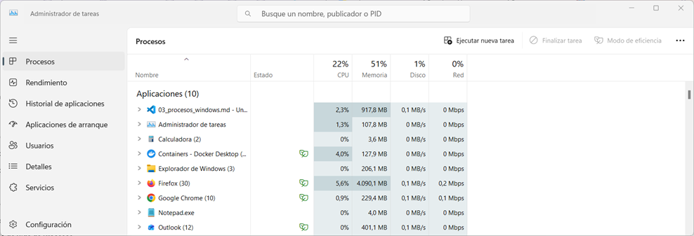
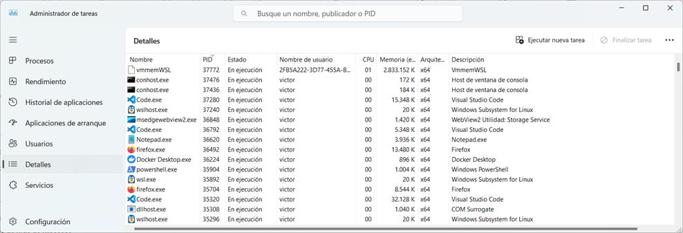
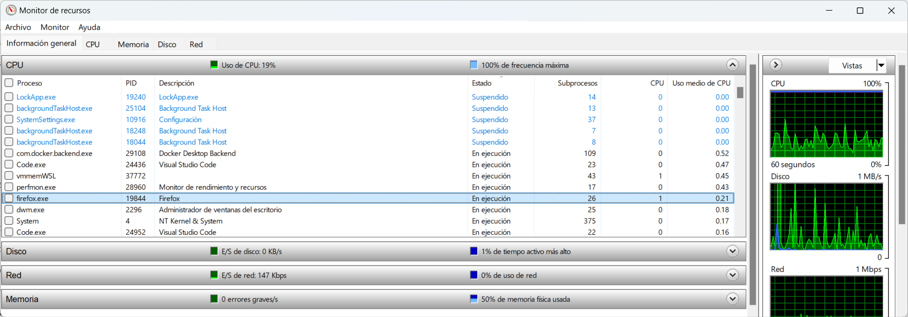
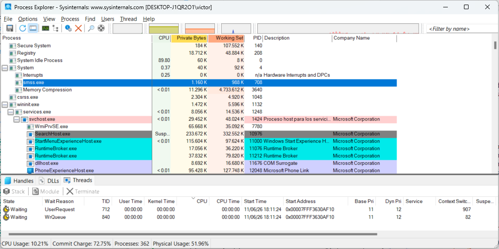

```
----------------- ADMINISTRACIÓN DE SISTEMAS INFORMÁTICOS EN RED ----------------
---------------------------------------------------------------------------------

Módulo:                     ADMINISTRACIÓN DE SISTEMAS OPERATIVOS
Profesor:                   Víctor J. González
Unidad de Trabajo:          UT05. Administración de procesos
Apartado:                   3. Procesos en Windows
Resultados de aprendizaje:  RA2
```


# UT04.- ADMINISTRACIÓN DE PROCESOS

## 3.- Procesos en Windows

### 3.1.- Arquitectura de arranque y jerarquía de procesos en Windows

A diferencia de los sistemas Unix/Linux, donde toda la jerarquía de procesos nace de un único proceso raíz en espacio de usuario (`systemd` o `init` con `PID 1`), la arquitectura de Windows separa desde el inicio el núcleo del sistema operativo de las sesiones de usuario mediante un aislamiento denominado **Session 0 Isolation**.

Cuando el equipo arranca, el *kernel* crea una cadena secuencial de procesos críticos del sistema antes de que el usuario pueda iniciar sesión:

```text
System (PID 4)
 └── smss.exe (Gestor de sesiones)
      ├── csrss.exe (Sesión 0)
      ├── wininit.exe (Inicialización de servicios - Sesión 0)
      │    ├── services.exe (Service Control Manager - SCM)
      │    │    ├── svchost.exe (Servicios de red, RPC, etc.)
      │    │    ├── svchost.exe (Windows Update, audio, etc.)
      │    │    └── spoolsv.exe (Cola de impresión)
      │    └── lsass.exe (Autenticación y seguridad local)
      └── winlogon.exe (Inicio de sesión interactivo - Sesión 1)
           ├── dwm.exe (Administrador de ventanas del escritorio)
           └── explorer.exe (Interfaz gráfica de usuario)
                ├── firefox.exe
                └── WindowsTerminal.exe
                     └── pwsh.exe (PowerShell)
```

Los principales componentes de la jerarquía son:

- **`System` (`PID 4`) y `System Idle Process` (`PID 0`):**
  - El **`PID 0`** (*Proceso inactivo del sistema*) no es un proceso real con código ejecutable, sino un contador que utiliza el planificador del *kernel* para medir el porcentaje de tiempo que cada núcleo de la CPU permanece libre.
  - El **`PID 4`** (`System`) aloja los hilos que se ejecutan directamente en **modo núcleo** (*Kernel Mode*), encargados de gestionar la memoria virtual, los controladores de dispositivos (*drivers*), el sistema de archivos y la planificación de hilos.
- **`smss.exe` (*Session Manager Subsystem*):** es el primer proceso real en **modo usuario** (*User Mode*). Crea las variables de entorno del sistema, carga el subsistema gráfico básico y divide el arranque en dos entornos aislados:
    - **Sesión 0 (Servicios no interactivos):** reservada exclusivamente para los procesos automáticos del sistema operativo, evitando que un servicio con privilegios elevados (`SYSTEM`) pueda interactuar directamente con el escritorio de un usuario (medida de seguridad frente a ataques de elevación de privilegios).
    - **Sesión 1, 2... (Sesiones de usuario):** cada usuario que inicia sesión (localmente o por Escritorio Remoto) recibe su propio espacio de sesión aislado.
- **`wininit.exe` y los procesos del sistema (Sesión 0):** lanza la infraestructura fundamental que mantiene operativo el equipo en segundo plano:
    - **`services.exe` (*Service Control Manager* - SCM):** es el equivalente funcional a `systemd` para los servicios de Windows. Se encarga de arrancar, detener y supervisar todos los servicios configurados en el sistema.
    - **`svchost.exe` (*Service Host*):** en Windows, muchos servicios del sistema no son ejecutables independientes (`.exe`), sino bibliotecas dinámicas (`.dll`). Para ahorrar memoria RAM, `services.exe` agrupa varios servicios dentro de un mismo proceso contenedor llamado `svchost.exe`, motivo por el cual es habitual ver decenas de instancias simultáneas en el Administrador de tareas.
    - **`lsass.exe` (*Local Security Authority Subsystem Service*):** gestiona la autenticación de usuarios, las directivas de seguridad locales, los *tokens* de acceso y el protocolo Kerberos o NTLM.
- **`winlogon.exe` y el entorno interactivo (Sesión 1):** Controla la pantalla de inicio de sesión segura (`Ctrl + Alt + Supr`). Una vez validada la contraseña del usuario, lanza:
    - **`explorer.exe`:** el explorador de Windows, que dibuja la barra de tareas, el menú Inicio y el escritorio. Actúa como **proceso padre** de todas las aplicaciones interactivas que el usuario abre mediante interfaz gráfica.
    - **`dwm.exe` (*Desktop Window Manager*):** renderiza la composición visual de las ventanas, transparencias y efectos gráficos.


## 3.2.- Herramientas gráficas de monitorización e inspección (GUI)

En entornos Windows, la administración de procesos cuenta con herramientas gráficas nativas y avanzadas que ofrecen distintos niveles de profundidad diagnóstica, desde la supervisión rápida de consumo hasta el análisis forense de hilos, bibliotecas y bloqueos.

### 1. Administrador de tareas (`taskmgr.exe`)

Es la herramienta de primera línea para supervisar el rendimiento general y gestionar procesos activos. Se abre mediante el atajo `Ctrl + Mayús + Esc`, haciendo clic derecho en la barra de tareas o ejecutando `taskmgr`.

**Pestaña *Procesos***

Arupa los procesos en tres bloques funcionales: *Aplicaciones* (ventanas abiertas en primer plano), *Procesos en segundo plano* (tareas auxiliares y demonios de usuario) y *Procesos de Windows* (servicios críticos del sistema operativo). Muestra el consumo porcentual de CPU, memoria, disco y red, y permite desplegar los subprocesos o pestañas internas de una aplicación (por ejemplo, cada pestaña del navegador).



Aquí podemos ver que algunos procesos están en estado *Suspendido* (icono de hoja verde / *Modo eficiencia*). A diferencia de Linux (donde la suspensión `T` suele aplicarse manualmente con `Ctrl + Z`), Windows gestiona de forma automática la suspensión de aplicaciones modernas (UWP/Microsoft Store) minimizadas y permite activar el **Modo de eficiencia** sobre procesos en segundo plano para reducir su prioridad al mínimo y ahorrar energía y memoria RAM.


**Pestaña *Detalles***

Equivale a la salida de `ps aux` o `top` en Linux, mostrando los ejecutables reales (`.exe`), su identificador numérico (**`PID`**), el usuario propietario, el consumo de memoria física y el estado actual (*En ejecución* o *Suspendido*). Desde el menú contextual (clic derecho) sobre cualquier proceso ofrece operaciones avanzadas:
    - **Finalizar árbol de procesos:** detiene no solo el proceso seleccionado, sino también todos los procesos hijos que haya creado.
    - **Establecer prioridad:** permite modificar dinámicamente la clase de prioridad de planificación (desde *Baja* hasta *Tiempo real*).
    - **Establecer afinidad:** restringe en qué núcleos lógicos concretos de la CPU tiene permiso para ejecutarse ese proceso.
    - **Ir a servicios:** salta directamente a la pestaña *Servicios* resaltando qué servicio o servicios están alojados dentro de ese proceso (imprescindible para inspeccionar instancias de `svchost.exe`).




### 2. Monitor de recursos (`resmon.exe`)

Accesible desde la pestaña *Rendimiento* del Administrador de tareas (*Abrir el Monitor de recursos*) o ejecutando `resmon`, proporciona una visión granular por subsistema (CPU, Memoria, Disco y Red) cuando se necesita diagnosticar un cuello de botella real.

Algunas tareas que podemos realizar desde el monitor de recursos son:

- **Suspensión y reanudación manual de procesos:** en la pestaña **CPU**, haciendo clic derecho sobre cualquier proceso, permite ejecutar **Suspender proceso** y **Reanudar proceso**. Esta función replica gráficamente el comportamiento de las señales `SIGSTOP` y `SIGCONT` de Linux, congelando los hilos del proceso en memoria sin cerrarlo.
- **Análisis de cadena de espera:** cuando una aplicación deja de responder, el Monitor de recursos permite analizar su **cadena de espera**. Esta herramienta inspecciona los hilos bloqueados y muestra gráficamente qué otro proceso, hilo o recurso compartido (un archivo bloqueado, una llamada de red o un *mutex*) está reteniendo la ejecución del proceso bloqueado.
- **Monitorización de E/S por proceso:** en las pestañas **Disco** y **Red** detalla exactamente qué archivo concreto está leyendo o escribiendo cada `PID` (en bytes/segundo) y qué puertos TCP/UDP tiene abiertos.





### 3. Process Explorer (Microsoft Sysinternals)

**Process Explorer** (`procexp.exe`) es la herramienta estándar de referencia para administradores de sistemas Windows y técnicos de soporte avanzado, ya que combina en una única interfaz las capacidades de `pstree`, `htop`, `lsof` y `strace` de Linux. Se puede obtener descargándolo de [esta URL](https://learn.microsoft.com/en-us/sysinternals/downloads/process-explorer).


A diferencia del Administrador de tareas (que agrupa por ventanas), Process Explorer muestra por defecto la **jerarquía exacta de creación (`PID` y `PPID`)** indentada en árbol y colorea cada fila según su naturaleza:
    - **Rosa:** procesos que alojan servicios de Windows (`svchost.exe` y servicios propios).
    - **Azul:** procesos que se ejecutan bajo la misma cuenta de usuario que el administrador actual.
    - **Verde / Rojo (parpadeo breve):** procesos recién creados (verde) o recién finalizados (rojo) en tiempo real.
    - **Morado:** procesos empaquetados o comprimidos (útil para detectar ejecutables sospechosos).



Al seleccionar un proceso en el panel superior y activar el panel inferior (`Ctrl + L`), permite elegir entre dos vistas críticas:
    - **Vista de manejadores (*Handles*, `Ctrl + H`):** lista todos los recursos del sistema operativo que el proceso tiene abiertos en ese instante (archivos en disco, claves del Registro de Windows, *threads*, puertos o eventos). Permite desbloquear archivos que Windows impide borrar ("el archivo está abierto en otro programa") buscando qué `PID` posee su *handle*.
    - **Vista de bibliotecas (*DLLs*, `Ctrl + D`):** muestra todas las bibliotecas dinámicas cargadas en el espacio de direcciones del proceso y su ruta en disco.

**Inspección de hilos y seguridad:** haciendo doble clic sobre un proceso se abre su ficha técnica (*Properties*), donde en la pestaña **Threads** se visualizan cada uno de sus hilos individuales (`TID`), su consumo de CPU y su pila de llamadas (*Stack*), y en la pestaña **Image** se puede verificar la firma digital del ejecutable o enviarlo directamente a VirusTotal.


### 3.3.- Administración de procesos desde consola: CMD vs. PowerShell

Para automatizar tareas administrativas o diagnosticar servidores sin interfaz gráfica (como *Windows Server Core*), es indispensable dominar la gestión de procesos por línea de comandos. Mientras que el símbolo del sistema clásico (**CMD**) utiliza comandos externos heredados que devuelven texto plano, **PowerShell** trabaja con **objetos .NET**, lo que permite filtrar, ordenar y canalizar propiedades exactas mediante tuberías (`|`) sin necesidad de recortar texto manualmente.

---

#### 1. Inspección y listado de procesos (`tasklist` vs. `Get-Process`)

* **En CMD (`tasklist`):**
Muestra la lista de procesos activos en el equipo local (o en un equipo remoto mediante `/S`).

```cmd
tasklist                          :: Listado básico (Nombre, PID, Sesión, Memoria)
tasklist /v                       :: Modo detallado (incluye Estado, Usuario, Tiempo CPU y Título de ventana)
tasklist /svc                     :: Muestra qué servicios de Windows aloja cada proceso (clave para svchost.exe)
tasklist /fi "MEMUSAGE gt 100000" :: Filtra procesos que consuman más de 100 MB de RAM

```

* **En PowerShell (`Get-Process` y consultas CIM/WMI):**
`Get-Process` (alias `gps` o `ps`) devuelve objetos completos con propiedades de memoria, CPU, hilos e identificadores. Sin embargo, para consultar el proceso padre (`ParentProcessId`) o la ruta y argumentos exactos con los que se lanzó el programa (`CommandLine`), se recurre a la clase instrumental `Win32_Process`:

```powershell
# Listar todos los procesos ordenados por consumo de CPU (top 10)
Get-Process | Sort-Object CPU -Descending | Select-Object -First 10 Id, ProcessName, CPU, WorkingSet

# Consultar el árbol de parentesco (PID, PPID) y la línea de comandos exacta
Get-CimInstance Win32_Process | Select-Object ProcessId, ParentProcessId, Name, CommandLine

# Inspeccionar los hilos internos (Threads) de un proceso concreto
(Get-Process -Name explorer).Threads | Select-Object Id, ThreadState, PriorityLevel

```

---

#### 2. Ejecución y control de prioridades (`start` vs. `Start-Process`)

A diferencia de Linux (que emplea `nice` y `renice`), en Windows la prioridad de planificación se establece al iniciar el binario o modificando la propiedad `PriorityClass` del objeto proceso en tiempo de ejecución.

* **En CMD (`start`):**
Permite lanzar aplicaciones especificando su prioridad inicial (`/low`, `/belownormal`, `/normal`, `/abovenormal`, `/high`, `/realtime`) y si deben ejecutarse en la misma consola (`/B`) o esperar a que terminen (`/WAIT`):

```cmd
start /belownormal /B copia_seguridad.bat

```

* **En PowerShell (`Start-Process` y ajuste dinámico):**

```powershell
# Iniciar un proceso minimizado y capturar su objeto en una variable (-PassThru)
$proc = Start-Process notepad.exe -WindowStyle Minimized -PassThru

# Modificar dinámicamente su clase de prioridad (equivalente a renice)
$proc.PriorityClass = 'BelowNormal'

# Cambiar la prioridad de un proceso ya existente por su PID
(Get-Process -Id 4512).PriorityClass = 'High'

```

---

#### 3. Finalización de procesos (`taskkill` vs. `Stop-Process`)

En Windows no existen las señales POSIX (`SIGTERM` / `SIGKILL`) como en Linux; en su lugar, el sistema distingue entre solicitar un cierre ordenado (enviando el mensaje gráfico `WM_CLOSE` a la ventana principal del programa) o forzar la terminación inmediata desde el *kernel* mediante la llamada `TerminateProcess()`.

* **En CMD (`taskkill`):**
Permite terminar procesos por identificador (`/PID`) o por nombre de imagen (`/IM`). El modificador `/F` fuerza el cierre inmediato y `/T` elimina también todo su árbol de procesos hijos:

```cmd
taskkill /PID 3412                   :: Solicita cierre ordenado (sin forzar)
taskkill /IM notepad.exe /F          :: Cierra forzosamente todas las instancias del Bloc de notas
taskkill /PID 3412 /T /F             :: Mata forzosamente el proceso 3412 y todos sus procesos hijos

```

* **En PowerShell (`Stop-Process`):**
Por defecto intenta cerrar el proceso; añadiendo `-Force` ejecuta la terminación inmediata sin pedir confirmación:

```powershell
Stop-Process -Id 3412 -Force
Stop-Process -Name "chrome" -Force

# Ejemplo de potencia de objetos: cerrar todos los procesos que no respondan
Get-Process | Where-Object { -not $_.Responding } | Stop-Process -Force

```

---

#### 4. Ejecución en segundo plano (*Background Jobs*)

Para ejecutar tareas largas sin bloquear el intérprete de comandos actual:

* **En CMD:** Se utiliza `start /B comando` para lanzarlo en la misma ventana de consola sin abrir una nueva, aunque su salida seguirá mezclándose en pantalla si no se redirige (`> salida.log 2>&1`).
* **En PowerShell:** Se utiliza el sistema de trabajos en segundo plano (*Jobs*), donde cada trabajo se ejecuta en un subproceso aislado y almacena su salida en memoria hasta que el administrador la consulta:

```powershell
# 1. Iniciar una tarea pesada en segundo plano (equivalente a '&' en Bash)
Start-Job -Name "EscaneoRed" -ScriptBlock { Test-Connection 192.168.1.1 -Count 20 }

# 2. Listar los trabajos activos de la sesión (equivalente a 'jobs')
Get-Job

# 3. Recuperar los resultados generados sin borrarlos del búfer (-Keep)
Receive-Job -Name "EscaneoRed" -Keep

# 4. Detener y limpiar el trabajo una vez finalizado
Stop-Job -Name "EscaneoRed"
Remove-Job -Name "EscaneoRed"

```

---

#### Tabla resumen de equivalencias Linux — CMD — PowerShell

| Tarea administrativa | Linux (Bash) | Windows (CMD) | Windows (PowerShell) |
| --- | --- | --- | --- |
| **Listar procesos activos** | `ps aux` | `tasklist` | `Get-Process` |
| **Ver `PID`, `PPID` y argumentos** | `ps -ef` | `tasklist /v` | `Get-CimInstance Win32_Process` |
| **Ver servicios dentro de procesos** | `systemctl status` | `tasklist /svc` | `Get-CimInstance Win32_Service` |
| **Lanzar con prioridad baja** | `nice -n 10 cmd` | `start /belownormal cmd` | `Start-Process` + `.PriorityClass = 'BelowNormal'` |
| **Cambiar prioridad en caliente** | `renice -n 10 -p PID` | *(Requiere PowerShell / WMI)* | `(Get-Process -Id PID).PriorityClass = 'Low'` |
| **Finalizar proceso por ID** | `kill -9 PID` | `taskkill /PID PID /F` | `Stop-Process -Id PID -Force` |
| **Finalizar por nombre** | `pkill -9 nombre` | `taskkill /IM nombre.exe /F` | `Stop-Process -Name nombre -Force` |
| **Ejecutar en segundo plano** | `comando &` / `jobs` | `start /B comando` | `Start-Job` / `Get-Job` / `Receive-Job` |